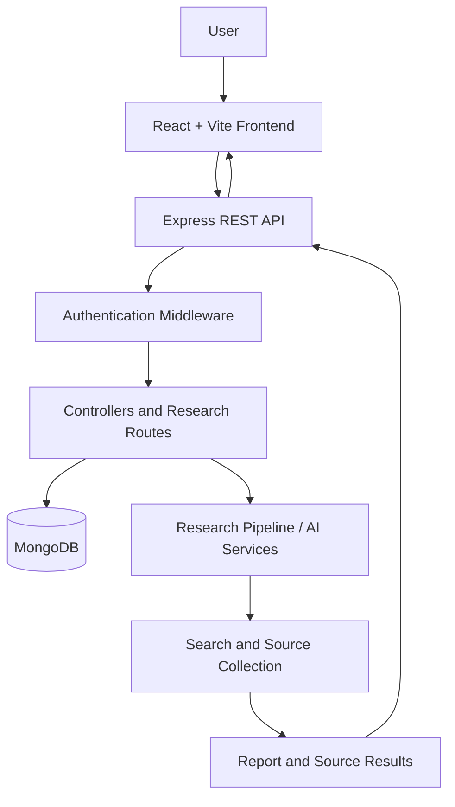

<div align="center">

# ✦ ResearchOS

### Ask a focused question. Get a structured, source-backed research report.

An AI-powered research workspace with authentication, saved history, source inspection, and report feedback — built end to end with the MERN stack.

[](https://react.dev/)
[](https://vite.dev/)
[](https://nodejs.org/)
[](https://expressjs.com/)
[](https://www.mongodb.com/)
[](https://research-os-tawny.vercel.app)
[](https://ai-research-p8ou.onrender.com/health)

### [🚀 Live Demo](https://research-os-tawny.vercel.app) &nbsp;·&nbsp; [🩺 API Health](https://ai-research-p8ou.onrender.com/health) &nbsp;·&nbsp; [🏗️ Architecture](#architecture) &nbsp;·&nbsp; [📡 API](#api-reference)

</div>

---

> **Note:** The backend runs on a free-tier host and may take ~30–60 seconds to wake on the first request. Please allow a moment, then refresh.

## Screenshots


<div align="center">

| Research workspace | Report & sources |
| :---: | :---: |
|  |  |

</div>

## Overview

ResearchOS is a full-stack research workspace for investigating a question, reading a generated report, and inspecting the sources behind it. Each session is scoped to a single topic, so the report, sources, and feedback always stay tied to the question that produced them.

**What it demonstrates**

- Full-stack architecture with a decoupled React frontend and Express API
- Secure, cookie-based authentication (JWT in `httpOnly` cookies)
- Per-user data ownership and protected routes
- Integration of an AI/search pipeline into a clean product experience
- Production deployment across two platforms with CORS and cross-site cookie handling

## Features

| | Feature | Description |
|---|---|---|
| 🔎 | **AI-assisted research** | Submit a focused question and receive a synthesized report. |
| 📚 | **Source inspection** | Review the sources associated with every report. |
| 🕘 | **Research history** | Reopen any previous session from the sidebar. |
| 🎯 | **One topic per session** | Completed sessions are locked to their original question, keeping results coherent. |
| ⭐ | **Report feedback** | Rate a report and optionally leave written feedback. |
| 🔐 | **Authentication** | Register, log in, restore the session on reload, and log out. |
| 🛡️ | **Protected API** | User-specific endpoints guarded by authentication middleware. |
| 📱 | **Responsive UI** | Chat, history, report, and source panels adapt to desktop and mobile. |

## Tech Stack

| Layer | Technology |
|---|---|
| Frontend | React, Vite |
| API server | Node.js, Express |
| Authentication | JWT, `httpOnly` cookies |
| Database | MongoDB, Mongoose |
| Research workflow | AI-assisted research pipeline with report and source presentation |
| Deployment | Vercel (frontend), Render (backend) |

## Architecture



The frontend manages the workspace and session state. The backend handles authentication, enforces authorization, persists records, and orchestrates the research workflow.

## How It Works

**Authentication**
1. A user registers or logs in; the server validates credentials and signs a JWT.
2. The token is issued in an `httpOnly` cookie.
3. On load, the frontend calls `/api/auth/me` to restore the session.
4. Protected routes require a valid authenticated user.

**Research session**
1. The user submits a focused question.
2. The backend runs the research workflow.
3. The report and its sources are returned and saved.
4. The frontend renders the report, source list, and feedback controls.
5. The session stays tied to its topic — new questions start a new session.

**Feedback**
Users can rate a completed report and add optional written feedback, stored against that report.

## API Reference

Protected routes require an authenticated session.

| Method | Endpoint | Auth | Purpose |
|---|---|:---:|---|
| `GET` | `/health` | — | Check that the API is responding |
| `POST` | `/api/auth/register` | — | Create an account |
| `POST` | `/api/auth/login` | — | Log in |
| `POST` | `/api/auth/logout` | ✅ | Log out |
| `GET` | `/api/auth/me` | ✅ | Get the current user |
| `GET` | `/api/chat` | ✅ | List research sessions |
| `POST` | `/api/chat` | ✅ | Start a research session |
| `GET` | `/api/chat/:id` | ✅ | Retrieve a research session |
| `POST` | `/api/chat/feedback/:id` | ✅ | Submit feedback for a report |

## Project Structure

```text
ResearchOS/
├── frontend/
│   ├── src/
│   │   ├── components/
│   │   ├── pages/
│   │   ├── context/
│   │   ├── lib/
│   │   └── App.jsx
│   ├── package.json
│   └── .env.example
└── backend/
    ├── controllers/
    ├── middlewares/
    ├── models/
    ├── routes/
    ├── app.js
    ├── server.js
    ├── package.json
    └── .env.example
```

## Getting Started

### Prerequisites

- Node.js and npm
- A MongoDB instance (local or hosted)
- API credentials for the configured research/search/LLM providers

### 1. Clone

```bash
git clone <YOUR_REPOSITORY_URL>
cd ResearchOS
```

### 2. Backend

```bash
cd backend
npm install
cp .env.example .env
```

Fill in `.env` using the variable names from `.env.example`:

```env
NODE_ENV=development
PORT=5000
JWT_SECRET=replace_with_a_long_random_secret
CLIENT_URL=http://localhost:5173
# + database URL and research-provider keys
```

```bash
npm run dev
```

### 3. Frontend

In a second terminal:

```bash
cd frontend
npm install
cp .env.example .env
```

```env
VITE_API_URL=http://localhost:5000/api
```

```bash
npm run dev
```

Open the URL printed by Vite (usually `http://localhost:5173`).

> Never commit `.env` files or real API keys. `VITE_`-prefixed variables are bundled into client code and must never hold secrets.

## Deployment

<details>
<summary><b>Frontend → Vercel</b></summary>

1. Import the repository and set the root directory to `frontend` (if monorepo).
2. Build command: `npm run build` · Output directory: `dist`.
3. Set the production API URL to `https://ai-research-p8ou.onrender.com` (or its `/api` base, depending on how the API client builds paths).
4. Redeploy after changing environment variables.

</details>

<details>
<summary><b>Backend → Render</b></summary>

1. Create a Node.js Web Service with root directory `backend`.
2. Use the install and start commands from `backend/package.json`.
3. Set the database URL, `JWT_SECRET`, `NODE_ENV=production`, provider API keys, and `CLIENT_URL=https://research-os-tawny.vercel.app`.
4. Make sure the server listens on `process.env.PORT`.
5. Verify with `/health`.

</details>

<details>
<summary><b>CORS & cross-site cookies</b></summary>

- Allow the exact frontend origin and enable credentialed requests on the server.
- Send credentials from the client (`credentials: "include"` or `withCredentials: true`).
- In production, cross-site cookies need `SameSite=None; Secure; HttpOnly`, with matching attributes when clearing them.
- For the most robust setup, serve the frontend and API from subdomains of one custom domain to avoid third-party-cookie blocking.

</details>

## Security

- Password verification and JWT signing happen server-side only
- Strong, private `JWT_SECRET`; rotate immediately if exposed
- `httpOnly` + `Secure` cookies in production
- Request-body and research-question validation on the backend
- Ownership checks so users can only access their own sessions and feedback
- CORS restricted to trusted frontend origins
- Rate limiting and request-size limits on auth and research endpoints
- Research output and external source content treated as untrusted data

## Troubleshooting

| Symptom | What to check |
|---|---|
| `401` from `/api/auth/me` | Log in again; confirm the cookie is stored and sent; verify credential settings on the client. |
| CORS error | Confirm the exact frontend origin is allowed and CORS middleware runs before routes. |
| Cookie blocked | Check `SameSite`/`Secure` attributes, browser privacy settings, and cross-site domain setup. |
| Research request fails | Check Render logs, provider API keys, quotas, and request timeouts. |
| Frontend can't reach API | Verify the production API URL and redeploy after env changes. |
| Slow first request | The free-tier backend may be waking from idle. |

## Roadmap

- [ ] Streaming progress and partial report output
- [ ] Task status and cancellation
- [ ] Export reports to Markdown / PDF
- [ ] Source-quality indicators and citation validation
- [ ] Search filters and report organization
- [ ] Observability and AI cost tracking
- [ ] Automated tests for auth, ownership, and feedback
- [ ] Background workers for long-running jobs

## Responsible Use

AI-generated reports can contain errors or incomplete interpretations. Check the cited sources and independently verify important claims before relying on them.

## License

Distributed under the MIT License. See [`LICENSE`](LICENSE) for details.

---

<div align="center">

**ResearchOS — AI-assisted research, with human judgment required.**

⭐ If you found this project interesting, consider giving it a star.

</div>
